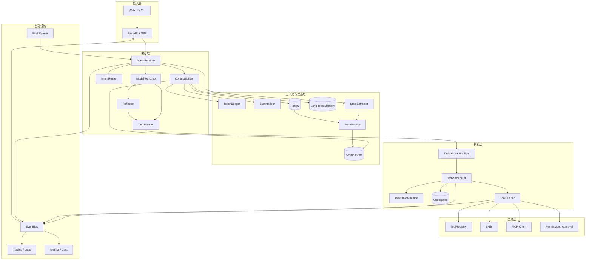

# 手搓 Agent 进阶课程 · 教学计划总览

> 配套代码：`agent-runtime`（`dev` 分支）
> 本文件是**总览与索引**；每课正文在 `lessonN.md`（如 `lesson5.md`）。
> 计划基于你的课程目录和当前仓库状态设计，课程视频与本文有出入时，以课程为准，本文负责「怎么落地、怎么验收」。
> 学习过程中卡住的问题记录在 [blockers.md](blockers.md)。

---

## 1. 这份计划怎么用

每一课都按同一个闭环推进：

```text
看课程视频 → 读 lessonN.md → 先写测试（红）→ 实现（绿）→ 跑验收 → 提交 → 勾掉进度
```

每一课都会给你：

- 本课目标、前置检查、明确「不做什么」
- 设计方案对比与选型理由
- 要新增/修改的文件清单 + 接口草图
- **完整可跑的测试代码**（pytest，默认不花钱、不依赖网络）
- 验收清单（DoD）与常见坑
- 与下一课的衔接点

---

## 2. 起点与目标形态

**当前起点（第 11 课结束）**

- 已有：`ToolRegistry` / `ToolRunner` / 事件模型 / `TaskPlan` / `TaskDAG` / `TaskConverter` / `TaskScheduler`
- 已有：`TaskPlanner` / `PlanRunner` / `IntentRouter` / `ChatResponder`，能分流聊天与任务
- 已有：`ToolCatalog`，Planner / Router 共用同一份工具能力目录
- 已有：`recommend_wine_pairing`，覆盖 list / Literal / 可选参数等复杂类型
- 已有：`ToolArgumentValidator`，Planner / Executor / Scheduler 三层参数校验
- 已有：`TokenBudget`，按预算保留 system / 最新 user，工具调用组原子化
- 已有：`validate_message_sequence`，校验 OpenAI 工具调用顺序
- 已有：`HistorySummarizer`，滚动摘要与上下文预览
- 测试：120 个用例通过
- 缺口：状态、可靠性、工具生态、可观测未开始

**第 36 课目标形态**

- 一句话触发「规划 → DAG 并发执行 → 失败重试/反思重规划 → 结果回填」
- 多会话、结构化状态、摘要、长期记忆，重启不丢
- 可暂停/取消/恢复，任务有检查点，副作用可幂等
- 工具可来自内置 / Skill / MCP，敏感工具有人工审批
- 全链路事件、追踪、成本统计、自动化评测
- 支持多用户与后台任务

---

## 3. 课程地图（6 个模块）

| 模块 | 课程 | 核心目标 | 里程碑验收 |
|---|---|---|---|
| 一、规划与 DAG 基础 | 1-4 | 把「一次 tool call」升级为「任务计划 + DAG 调度」 | 手写计划可并发执行（已完成） |
| 二、模型规划接入 | 5-9 | 让模型按协议产出计划，并做意图分流与严格校验 | 一句话触发多工具 DAG，端到端可跑 |
| 三、上下文与状态 | 10-20 | 预算、摘要、结构化状态、持久化、多会话隔离 | 换会话/重启后仍记得关键状态 |
| 四、执行可靠性 | 21-25 | 状态机、死锁检测、重试幂等、检查点、暂停恢复 | 中途杀掉进程可恢复，重跑无重复副作用 |
| 五、工具生态与安全 | 26-30 | 统一工具接口、Skill、MCP、权限审批、事件总线 | 接入一个 MCP Server + 一个需审批工具 |
| 六、可观测与生产化 | 31-36 | 追踪日志、评测、成本、长期记忆、反思、多用户 | 两用户并发 + 后台任务 + 评测报告 |

### 模块一：规划与 DAG 基础（第 1-4 课，已完成）

目标是把「模型说调什么工具」变成「可被校验、可并发执行的任务图」。你已经有了 `TaskPlan` 的协议校验、Kahn 拓扑排序与环检测、`TaskConverter` 的运行时转换，以及事件驱动的 `TaskScheduler`。这一模块的产出是后面所有课程的地基，尤其是第 22 课的死锁检测和第 24 课的检查点，都会复用 `TaskDAG` 的图结构。

### 模块二：模型规划接入（第 5-9 课，当前阶段）

这是把你从「手写计划」带到「模型生成计划」的关键模块。第 5 课先做一个独立、可单测的 `TaskPlanner`；第 6 课替换主循环里硬编码的 `dependencies: []`；第 7 课解决「这句话到底该聊天还是该规划」；第 8 课让规划器从工具 Schema 自动理解工具能力，而不是维护一份手写清单；第 9 课用 JSON Schema 做参数级校验，把模型的错误挡在执行之前。完成后，你的 Agent 应该能对「今天波尔多适合酿酒吗」自动产出 `T1 天气 → T2 时间 → T3 酿酒` 的 DAG 并执行。

### 模块三：上下文与状态（第 10-20 课）

从「每次请求都是新的」升级为「有记忆、有状态、可持久化」。第 10-11 课处理上下文预算与历史摘要；第 12-16 课建立结构化会话状态、自动提取变更、持久化与多会话隔离；第 17-20 课把状态和上下文接回模型调用，并统一历史管理。这一模块的关键是**状态与消息分离**：消息是流水账，状态是可查询、可合并、可持久化的结构化事实。

### 模块四：执行可靠性（第 21-25 课）

让长任务「跑得完、停得住、挂得起、恢复得了」。第 21 课把任务状态收敛成显式状态机；第 22 课做 DAG 预检与死锁检测；第 23 课做错误分类、重试与幂等；第 24 课引入检查点；第 25 课实现暂停/取消/恢复。验收方式很直接：执行到一半杀进程，重启后能接着跑。

### 模块五：工具生态与安全（第 26-30 课）

从「几个内置函数」扩展到「可组合、可接入、可管控」的工具系统。第 26 课统一工具接口与错误模型；第 27 课实现 Skill（多步配方）；第 28 课接 MCP Client；第 29 课加权限策略与人工审批；第 30 课把所有事件收敛到统一事件总线，为 SSE、日志、追踪提供单一出口。

### 模块六：可观测与生产化（第 31-36 课）

把「能跑」变成「可诊断、可评估、可运营」。第 31 课做追踪与结构化日志；第 32 课建立评测集与回归指标；第 33 课统计 token 成本并优化性能；第 34 课接入长期记忆与知识检索；第 35 课让 Agent 在失败后反思并重新规划；第 36 课做多用户隔离、后台执行与完整验收。

---

## 4. 36 课清单与进度

| 课 | 主题 | 本课产出 | 状态 |
|---|---|---|---|
| 1 | 从 Tool Calling 到任务规划 | 多步工具调用 demo，理解「计划」的必要性 | ✅ |
| 2 | 设计统一任务计划协议 | `TaskPlan` / `PlannedTask` 数据模型 | ✅ |
| 3 | 从任务计划构建 DAG | `TaskDAG`：Kahn 拓扑排序 + 环检测 | ✅ |
| 4 | 计划转 Task 并接入调度器 | `TaskConverter` + 事件驱动 `TaskScheduler` | ✅ |
| 5 | 让模型按协议生成计划 | `TaskPlanner` + `submit_task_plan` + 校验修复 | ✅ |
| 6 | 接入 Agent Runtime | 替换 `dependencies: []` 硬编码，接 `TaskPlanExecutor` | ✅ |
| 7 | 区分普通对话与任务规划 | `IntentRouter`：闲聊直达 / 任务进规划 | ✅ |
| 8 | 理解工具真实能力 | `ToolCatalog`：从 Schema/docstring 生成能力摘要 | ✅ |
| 9 | 严格工具参数校验 | JSON Schema 校验 + 错误回填 | ✅ |
| 10 | 上下文预算管理 | `TokenBudget`：计数、裁剪、优先级 | ✅ |
| 11 | 对话历史摘要 | 滚动摘要，保留关键事实 | ✅ |
| 12 | 结构化会话状态 | `SessionState` 模型（偏好、目标、约束、进度） | ⬜ |
| 13 | 自动提取状态变更 | `StateExtractor` → `StateDelta` | ⬜ |
| 14 | 状态持久化 | SQLite `StateStore` | ⬜ |
| 15 | 多会话状态隔离 | `session_id` 隔离与并发安全 | ⬜ |
| 16 | 状态变更闭环 | `StateService`：应用、版本、冲突处理 | ⬜ |
| 17 | 状态接入模型上下文 | `StateRenderer` + 预算内注入 | ⬜ |
| 18 | 上下文接入 Runtime | `ContextBuilder` 组装 messages | ⬜ |
| 19 | 状态更新接入对话流程 | 回合后提取、异步更新、幂等 | ⬜ |
| 20 | 统一历史管理与持久化 | 消息/摘要/状态快照统一存储与保留策略 | ⬜ |
| 21 | 任务状态机 | 显式 FSM + 合法转换守卫 | ⬜ |
| 22 | DAG 校验与死锁检测 | 预检：环、不可达、无进展、超时 | ⬜ |
| 23 | 安全重试与幂等 | 错误分类、退避、幂等键 | ⬜ |
| 24 | 检查点与任务恢复 | 任务级 checkpoint + resume | ⬜ |
| 25 | 暂停、取消与恢复 | 取消令牌、边界暂停、断点续跑 | ⬜ |
| 26 | 统一工具接口与错误处理 | `Tool` 协议、`ToolResult`、错误分类 | ⬜ |
| 27 | 实现 Skill | 组合工具/多步配方 + 注册机制 | ⬜ |
| 28 | 实现 MCP Client | 连接、发现工具、调用、生命周期 | ⬜ |
| 29 | 工具权限与人工审批 | 权限策略 + 审批门 + SSE 交互 | ⬜ |
| 30 | 统一事件总线 | pub/sub、事件持久化、SSE 适配 | ⬜ |
| 31 | 运行追踪与结构化日志 | trace/span、JSON 日志、事件关联 | ⬜ |
| 32 | Agent 自动化评测 | 评测集、指标、回归报告 | ⬜ |
| 33 | 成本统计与性能优化 | token 计费、缓存、并发调优 | ⬜ |
| 34 | 长期记忆与知识检索 | 记忆存储、检索、按需注入 | ⬜ |
| 35 | 失败反思与重新规划 | `Reflector`：诊断 → 修订计划 | ⬜ |
| 36 | 多用户隔离、后台执行与验收 | 用户隔离、任务队列、端到端验收 | ⬜ |

> 状态标记：`✅` 已完成，`⬜` 未开始，`🟡` 进行中。每课完成后更新这一列。

---

## 5. 目标架构（第 36 课形态）



### 分层职责

| 层 | 职责 | 主要课程 |
|---|---|---|
| 接入层 | HTTP、SSE、CLI、请求/响应模型 | 1、30、36 |
| 编排层 | 会话编排、意图分流、规划、主循环、反思 | 5-7、35 |
| 上下文与状态层 | 预算、摘要、结构化状态、历史、记忆 | 10-20、34 |
| 执行层 | DAG 校验、调度、状态机、检查点、恢复 | 3-4、21-25 |
| 工具层 | 注册、执行、Skill、MCP、审批 | 1、26-29 |
| 基础设施 | 事件总线、追踪、指标、评测、存储 | 30-33 |

### 一次请求的数据流

1. 请求进入 API，携带 `session_id` / `user_id`。
2. Runtime 载入会话状态、历史、摘要，`ContextBuilder` 在 token 预算内组装上下文。
3. `IntentRouter` 判断：闲聊直接回答；任务进入规划。
4. `TaskPlanner` 结合工具能力目录生成 `TaskPlan`。
5. Preflight 校验：DAG 合法、无死锁、参数合法、权限允许。
6. `TaskScheduler` 按依赖并发执行，状态机推进，每步可写检查点。
7. 失败时按策略重试；无法恢复则 `Reflector` 诊断并重规划；敏感操作走人工审批。
8. 结果回填上下文，状态提取并持久化；事件经总线推送 SSE、日志和指标。

---

## 6. 目标目录结构

> 标注「第 N 课」的是该课会新增或大改的位置；未标注的为现有结构。

```text
agent-runtime/
├── main.py
├── api/
│   ├── server.py
│   └── sse.py                     # 第 30 课：SSE 适配
├── agent/
│   ├── llm.py                     # 第 5 课：支持 tool_choice
│   ├── runtime.py
│   ├── model_tool_loop.py         # 第 6 课：接入 Planner
│   ├── planner.py                 # 第 5 课
│   ├── intent.py                  # 第 7 课
│   ├── reflection.py              # 第 35 课
│   └── prompts/                   # 提示词模板
├── tasks/
│   ├── plan.py
│   ├── dag.py
│   ├── converter.py
│   ├── scheduler.py
│   ├── models.py
│   ├── plan_executor.py
│   ├── state_machine.py           # 第 21 课
│   ├── preflight.py               # 第 22 课
│   └── checkpoint.py              # 第 24 课
├── context/
│   ├── budget.py                  # 第 10 课
│   ├── summarizer.py              # 第 11 课
│   └── builder.py                 # 第 18 课
├── state/
│   ├── models.py                  # 第 12 课
│   ├── extractor.py               # 第 13 课
│   ├── store.py                   # 第 14 课
│   ├── service.py                 # 第 16 课
│   └── history.py                 # 第 20 课
├── tools/
│   ├── registry.py
│   ├── catalog.py                 # 第 8 课
│   ├── runner.py
│   ├── builtin.py
│   ├── base.py                    # 第 26 课
│   ├── permissions.py             # 第 29 课
│   ├── skills/                    # 第 27 课
│   └── mcp/                       # 第 28 课
├── events/
│   ├── models.py
│   └── bus.py                     # 第 30 课
├── observability/
│   ├── tracing.py                 # 第 31 课
│   ├── logging.py                 # 第 31 课
│   └── metrics.py                 # 第 33 课
├── memory/                        # 第 34 课
├── eval/                          # 第 32 课
├── tests/
│   ├── unit/
│   ├── integration/
│   ├── e2e/                       # 需要真实 LLM，默认跳过
│   └── fixtures/fake_llm.py       # 第 5 课起复用
├── scripts/
│   └── lessonNN_smoke.py          # 每课真实调用冒烟脚本
└── docs/
    └── lessons/                   # 本计划
        ├── README.md              # 总览（本文件）
        ├── lesson5.md
        ├── lesson6.md
        └── ...
```

---

## 7. 测试与验收体系

每课都必须带测试，默认**不依赖网络和真实 API**。

### 分层

| 层 | 位置 | 依赖 | 运行时机 |
|---|---|---|---|
| 单元测试 | `tests/unit/` | 纯内存、FakeLLM | 每次提交 |
| 集成测试 | `tests/integration/` | 临时 SQLite、假 MCP Server | 每次提交 |
| 端到端 | `tests/e2e/` | 真实 LLM | 手动 / 标记跳过 |

### 约定

- 共享假模型放 `tests/fixtures/fake_llm.py`，从第 5 课开始复用。
- 真实调用测试打 `@pytest.mark.e2e`，默认 `pytest -m "not e2e"`。
- 每课至少覆盖：1 个正常路径 + 2 个边界/失败路径 + 1 个回归（上一课的行为不被破坏）。
- 每课文档里的测试代码是**可直接复制运行**的，不是伪代码。
- 验收命令统一：

```powershell
.venv\Scripts\python.exe -m pytest -m "not e2e" -q
```

### 每课文档模板

1. 本课目标与产出
2. 前置检查（命令 + 期望输出）
3. 背景与为什么现在做
4. 设计决策（方案对比 + 推荐）
5. 接口与数据结构（草图）
6. 实现步骤（分步，每步有完成标志）
7. **测试代码**（完整 pytest 用例）
8. 验收清单（DoD）
9. 常见坑与排查
10. 扩展 / 思考题
11. 与下一课衔接

---

## 8. 学习节奏与开发约定

**节奏建议**

- 每课 2-4 小时；每模块 1-2 周；全程约 10-14 周。
- 不要跳课：第 6 课依赖第 5 课的 `TaskPlanner`，第 18 课依赖第 10-17 课的上下文与状态。
- 每课结束先跑全量测试，再提交。

**分支与提交**

- `main`：跟课程博主的基线，只用于对照，不直接开发。
- `dev`：我们的开发分支；每模块结束可打 tag（如 `m2-planner`）。
- 提交信息用 conventional commits：`feat(planner): ...`、`test(scheduler): ...`、`fix(...)`。
- 一课通常 1-3 个提交：实现 + 测试 + 文档/冒烟脚本。

**工程约定**

- Python 3.12、Pydantic 2、pytest；沿用现有 `requirements.txt`，新增依赖要写明原因。
- 依赖方向保持单向：`events ← tools ← tasks ← agent ← api`；新增 `state/`、`context/`、`observability/` 时避免反向依赖。
- 每课只做本课的事，不提前搭后面课程的抽象；但接口要留出扩展点。
- 任何「为了跑通而临时硬编码」的地方，在课程文档里标注，并在对应课程移除。

---

## 9. 调整原则

- 本计划是**学习路线**，不是课程视频的逐字稿；视频里的实现细节如果更合理，以视频为准，回来更新本文件。
- 如果某课实际难度明显超出预估，可以拆成两课，但保持编号和依赖不变（用 `lessonN-a.md` / `lessonN-b.md`）。
- 每完成一个模块，回看一次架构图：确认新增模块的依赖方向没有变乱。

---

## 10. 下一步

- 第 11 课已完成：`HistorySummarizer` 已能滚动摘要并做上下文预览；下一步进入第 12 课（结构化会话状态）。
- 如果需要，我可以补写 `lesson1.md` ~ `lesson4.md` 作为复习与验收文档（代码已完成，主要用于巩固和查漏）。
