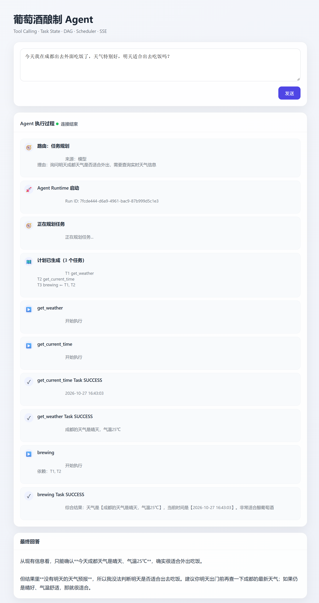
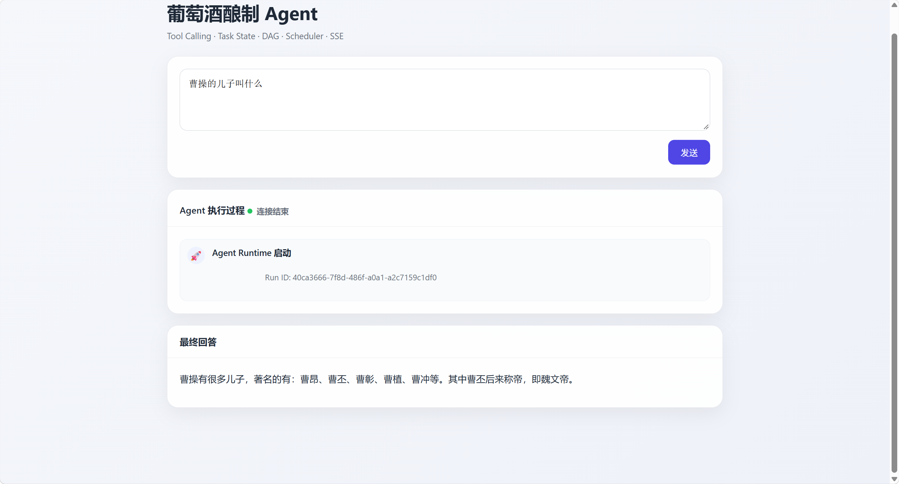

# 学习阻塞点记录

> 记录学习中真正卡住的问题，按课次/时间追加，方便以后回看和避免重复踩坑。
> 每条包含：现象 → 根因 → 解决 → 验证 → 教训。
> 新增记录请复制文末模板。

## 快速索引

| 日期 | 课次 | 阻塞点 | 状态 |
|---|---|---|---|
| 2026-10-26 | 环境 | 沙箱下 git 无法写 `.git` | 已解决（切完全权限） |
| 2026-10-26 | 第 5 课 | DeepSeek 400：thinking 模式不支持强制 tool_choice | 已解决 |
| 2026-10-26 | 第 5 课 | 工具参数名 `time` vs `current_time` | 已解决（prompt 补参数） |
| 2026-10-27 | 第 7 课 | 同一句话两次路由结果不同（chat / task） | 已解决（规则 + temperature=0） |
| 2026-10-27 | 第 7 课 | 日志不输出、业务日志被 HTTP 日志淹没 | 已解决（logging_config） |
| 2026-10-27 | 第 7 课 | 新增 `intent_detected` 导致 2 个 runtime 测试失败 | 已解决 |
| 2026-10-27 | 第 7 课 | `temperature` 参数与 `FakeLLM` 不匹配 | 已解决 |
| 2026-10-27 | 第 8 课 | 工具目录两处渲染，参数说明和能力边界丢失 | 已解决（ToolCatalog） |
| 2026-10-27 | 第 8 课 | `Literal` 只生成 `type`，没生成 `enum` | 已解决 |
| 2026-10-27 | 第 8 课 | Planner / Router 各自构建目录快照 | 已解决（共享实例） |
| 2026-10-28 | 第 8 课遗留 | `float \| None` 被渲染成 `string` | 已解决（UnionType） |
| 2026-10-28 | 环境 | `tools/` 子目录在受限沙箱下无法写/删 | 已解决（完全权限） |

---

## 环境问题（与课程代码无关）

### 2026-10-26 · git 无法创建分支 / 提交

- **现象**：`git switch -c dev` 报 `cannot lock ref 'refs/heads/dev' ... Permission denied`，但工作区根目录可以写。
- **根因**：DSH 沙箱以低完整性（Low Integrity）运行，而 `.git` 目录是普通完整性（Medium）。Windows 的「低完整性不能写高完整性」规则直接拒绝，和普通 ACL 权限是两回事。
- **尝试过**：修复 ACL（无效）、给 `.git` 打低完整性标记（需要提权，且只解决一半）。
- **最终解决**：把会话切到「完全权限」（full access），git 正常；之前为修权限做的 ACL/标签改动已撤销。
- **教训**：涉及 `.git` 写操作（切分支、commit）时，优先用完全权限会话；不要在 ACL 上耗时间。

### 2026-10-28 · workspace-write 下 `tools/` 子目录无法写/删

- **现象**：准备第 8 课材料时，临时实现的 `tools/catalog.py` 需要撤掉；`Remove-Item` 报 `Access to the path ... is denied`。同一会话里工作区根目录可以正常新建/删除文件，但 `tools/` 下不行。
- **根因**：DSH 的受限沙箱对该子目录的写入授权不完整；不是文件只读属性，也不是 Python 进程占用。`tools/` 的 ACL 缺少沙箱进程需要的授权，而工作区根目录有。
- **尝试过**：`Remove-Item -Force`、`cmd /c del`、`git checkout` 恢复文件，均被拒绝；没有手动改 ACL。
- **最终解决**：把这一次清理命令切到「完全权限」执行，恢复 4 个源文件并删除临时 `catalog.py`；没有留下 ACL 改动。
- **验证**：`git status --short` 只剩预期的教程和测试文件。
- **教训**：如果工作区根目录可写、某个子目录却稳定报 Access denied，先怀疑沙箱授权，不要反复试删除；清理临时文件时直接申请一次完全权限。

---

## 第 5 课：让模型按协议生成任务计划

### 5.1 · 400 Thinking mode does not support this tool_choice

- **现象**：planner 用 `tool_choice` 强制模型调用 `submit_task_plan`，冒烟直接报：

  ```text
  openai.BadRequestError: Error code: 400 -
  {'error': {'message': 'Thinking mode does not support this tool_choice'}}
  ```

- **根因**：`deepseek-flash` 默认开启思考模式（thinking enabled，effort 默认 high）；DeepSeek API 明确规定 thinking 模式下不支持 `required` 和「指定函数」这两种 `tool_choice`。
- **解决**：规划请求关闭思考模式。

  ```python
  # agent/llm.py
  if thinking is not None:
      kwargs["extra_body"] = {
          "thinking": {"type": "enabled" if thinking else "disabled"}
      }

  # agent/planner.py
  response = await self.llm.chat(..., thinking=False)
  ```

- **验证**：冒烟通过，能拿到 T1/T2/T3 计划。
- **补充**：thinking 模式 + `tools` 还要求后续请求把 `reasoning_content` 原样回传，否则同样 400；本课直接关闭 thinking，绕开这一层复杂度。
- **教训**：`FakeLLM` 只验证逻辑，不验证厂商 API 约束；新参数先跑冒烟。

### 5.2 · 工具参数名错了：`time` vs `current_time`

- **现象**：冒烟输出的 T3 是：

  ```json
  "arguments": {
    "weather": {"from_task": "T1"},
    "time": {"from_task": "T2"}
  }
  ```

  `TaskPlan` 校验通过，但真正执行时会：

  ```text
  TypeError: brewing() got an unexpected keyword argument 'time'
  ```

- **根因**：system prompt 里只给了 `- brewing: 根据天气和当前时间...`，没有给参数名和类型，模型只能按语义猜。
- **解决**：把工具目录渲染成「名字(参数: 类型)」，参数名来自 `ToolRegistry.get_tool_schema()`：

  ```text
  - brewing(weather: string, current_time: string): 根据天气和当前时间判断...
  ```

  实现见 `TaskPlanner._format_tool()`；冒烟后 `current_time` 稳定出现。
- **后续**：prompt 是软约束，参数级硬校验在第 9 课补；在第 9 课之前，计划合法不代表能执行。
- **教训**：「协议合法」和「工具可调用」是两回事，中间隔着参数校验。

---

## 第 7 课：区分普通对话与任务规划

### 7.1 · 同一句话两次路由结果不同（chat / task）

- **现象**：同一个输入：

  ```text
  今天我在成都出去外面吃饭了，天气特别好，明天适合出去吃饭吗？
  ```

  第一次走 `chat`，第二次走 `task`；第二次还规划出了：

  

  ```text
  T1 get_weather
  T2 get_current_time
  T3 brewing
  ```

  `brewing` 和“出去吃饭”毫无关系。

- **根因**：
  1. 分类器没有设置 `temperature`，默认采样；同一个 prompt 两次可能给出不同 `intent`。
  2. 输入本身两可：既有个人经历/闲聊，又提到成都、天气、明天。
  3. 工具只有 `get_weather`（当前天气），没有天气预报；prompt 没有明确“工具做不到就选 chat”。
  4. 规划器被“至少一个任务”约束，只能硬选一个工具，于是选中了 `brewing`。

- **解决**：
  - 规则预筛只处理高置信度的闲聊；
  - `IntentRouter` 和 `TaskPlanner` 请求加 `temperature=0`；`LLM.chat` 默认改为 `None`，只对显式调用生效；
  - 分类 prompt 增加“工具能力边界”：未来预报/实时新闻等现有工具做不到时选 chat；
  - 增加“不要为了让工具‘有用’而把无关问题判成 task”；
  - 分类失败统一回退 `chat`。

- **验证**：同一句话多跑几次，路由稳定；聊天路径截图：

  

  这条请求没有 `plan_*` / `task_*`，直接 `final_answer`，说明意图分流生效。

- **教训**：**LLM 分类器不是确定性的**；规则、temperature、prompt 边界、回退策略要一起用。

### 7.2 · 日志不输出、业务日志被 HTTP 日志淹没

- **现象**：`logger.info` 完全没有输出；打开日志后又被 `httpx2` 的每条 HTTP 200 刷屏，看不到意图和任务完成。
- **根因**：
  - 只有 `main.py` 里配置了 `basicConfig`；
  - `scripts/*.py` 直接运行，根 logger 还是默认 WARNING；
  - uvicorn `reload=True` 的子进程不会执行 `main.py`；
  - `httpx` / `httpx2` 的 INFO 日志和业务日志混在一起。
- **解决**：
  - 新增 `logging_config.py`，在 `main.py`、`api/server.py`、`scripts/*` 统一切调用 `setup_logging()`；
  - INFO 下把 `httpx` / `httpx2` / `httpcore` 压到 WARNING；
  - 增加路由意图、任务完成（带耗时）、执行汇总、最终回答完成等日志。
- **验证**：

  ```text
  [INFO] agent.runtime: 路由意图: task (source=llm, rule=-)
  [INFO] tasks.scheduler: 任务完成 T2 (工具: get_current_time) 耗时 2.01s
  [INFO] tasks.scheduler: 任务完成 T1 (工具: get_weather) 耗时 3.01s
  [INFO] agent.plan_runner: 任务执行结束: 成功=2, 失败=0
  ```

### 7.3 · 新增 `intent_detected` 导致 runtime 测试失败

- **现象**：全量测试从 `38 passed` 变成 `36 passed, 2 failed`。
- **根因**：事件序列多了一条 `INTENT_DETECTED`，原测试期望 3 条事件，且 `final_answer` 的下标从 `events[1]` 变成 `events[2]`。
- **解决**：更新 `test_runtime_routes_chat` / `test_runtime_routes_task` 的期望序列，并补：
  - `intent_detected.data` 的 `intent/source/rule/reason`；
  - 所有事件 `run_id` 一致；
  - 规则命中时只有 1 次 LLM 调用。
- **验证**：`60 passed`。

### 7.4 · `temperature` 参数与 `FakeLLM` 不匹配

- **现象**：给 `IntentRouter` / `TaskPlanner` 加 `temperature=0` 后，12 个测试失败：

  ```text
  TypeError: FakeLLM.chat() got an unexpected keyword argument 'temperature'
  ```

  分类调用被 `except Exception` 吞掉后回退 chat，导致 task 相关测试也连锁失败。

- **根因**：`LLM.chat` 新增了参数，但测试替身 `tests/fixtures/fake_llm.py` 的 `chat` 签名没同步。
- **解决**：给 `FakeLLM.chat` 增加 `temperature=None`，并在 `calls` 里记录。
- **验证**：`60 passed`。
- **教训**：**改 LLM 客户端签名时，必须同步所有测试替身**；否则失败会伪装成“路由逻辑错”。

### 7.5 · 顺手修的两个小问题

- `agent/__init__.py` 的 `__all__` 写了 `ChatResponder / Intent / IntentRouter`，但没有 import；`from agent import ChatResponder` 会失败。已补全。
- `runtime.py` 里 `decision.reason[:100]`，当模型返回 `"reason": null` 会 `TypeError`；已改成 `str(decision.reason or "")[:100]`。

### 7.6 · 本课设计结论

- 规则文件独立：`agent/chat_rules.py` 只做字符串匹配，不依赖 `Intent` / LLM。
- 规则只产出 `chat`，任务判断永远交给 LLM；失败回退 `chat`。
- `intent_detected` 由 `AgentRuntime` 发，`run_id` 统一生成后传给两个 runner。
- 结构化调用（路由、规划）用 `temperature=0`；聊天回答保留模型默认温度。

---

## 第 8 课：让规划器理解工具的真实能力

### 8.1 · 工具目录两处手写拼接，参数说明和能力边界丢失

- **现象**：Planner 和 Router 各自遍历 Registry 拼字符串：

  ```text
  Planner: - get_weather(city: string): 根据城市名获取当前天气信息...
  Router:  - get_weather: 根据城市名获取当前天气信息...
  ```

  Planner 只用了参数类型和必填，丢掉了参数说明、默认值；Router 连参数签名都没有。同一个工具在两处描述不一致。

- **根因**：渲染逻辑有两份，且都只消费了 `ToolRegistry` Schema 的一部分。Schema 里明明已经有 `description`、`default`、`enum` 等字段，却没有被带进 prompt。

- **解决**：新增 `ToolCatalog`，统一从 `registry.get_all_schemas()` 生成 `ToolSpec`：

  - `render()`：详细视图，给 Planner，包含参数名、类型、必填/可选、默认值、参数说明；
  - `render_compact()`：紧凑视图，给 Router，保留签名和完整能力边界；
  - Planner / Router 不再自己遍历 Registry。

- **验证**：
  - `18 passed`，全量 `78 passed`；
  - Planner prompt 包含 `city: string（必填）`、`城市名，使用中文或拼音`、`不能查询未来预报`；
  - Router prompt 包含 `- get_weather(city: string):`，但不包含 `### get_weather`。

- **教训**：**目录不是第二份工具定义，而是 Schema 的另一种渲染**。一旦两处各自维护描述，就一定会漂移。

### 8.2 · `Literal` 只生成 `type`，没生成 `enum`

- **现象**：参数写成 `Literal["dry", "sweet"]` 时，生成的 Schema 只有：

  ```json
  {"type": "string"}
  ```

  模型不知道只能填 `dry` / `sweet`，目录也显示不出可选值。

- **根因**：`_to_json_schema_type()` 只处理了基础类型、`list`、`Union`、`dict`，其他类型统一回退成 `string`。`Literal` 的 `get_origin` 不在已处理分支里。

- **解决**：增加 `Literal` 分支，生成 `type + enum`；`ToolParameter` 增加 `enum`，详细视图渲染成：

  ```text
  style: string（必填，可选值: dry | sweet）
  ```

- **验证**：`test_registry_literal_emits_enum_and_catalog_renders_it` 通过。

- **教训**：类型只说明「是什么」，`enum` 才说明「能取什么」。做工具目录时不能只搬 `type`。

### 8.3 · `float | None` 被渲染成 `string`（第 8 课遗留）

- **现象**：给新工具写 `budget: float | None = None`，Schema 和目录都显示成：

  ```text
  budget: string（可选，默认 null）
  ```

  类型完全错了；第 9 课如果用这份 Schema 校验，字符串预算也会被放行。

- **根因**：Python 3.10+ 的 `X | None` 是 `types.UnionType`，而 `typing.Optional[X]` 是 `typing.Union`。代码只判断了后者，前者落到了 `return {"type": "string"}`。

- **解决**：

  ```python
  if origin is Union or origin is types.UnionType:
      ...
  ```

- **验证**：`test_recommend_wine_pairing_schema_has_complex_types` 断言 `budget` 是 `number`；新工具测试 `4 passed`，基线 `82 passed`。

- **教训**：Python 3.10 之后有两种 union 写法，测试可选数值参数时一定要看生成的 Schema，不要只看函数注解。

### 8.4 · Planner / Router 各自构建目录快照

- **现象**：两边都调用 `ToolCatalog.from_registry(registry)`，内容相同，但不是同一个对象。当前 Registry 静态不变所以没出错，但：

  - 重复解析一遍 Schema；
  - 如果以后动态注册工具，两个快照可能版本不一致；
  - 目录指纹也变成两份。

- **根因**：构造函数默认各自建目录，没有注入点。

- **解决**：

  - `TaskPlanner` / `IntentRouter` 增加可选关键字参数 `catalog`；
  - `AgentRuntime` 只构建一次，`self.catalog` 保存并传给两边；
  - 启动时打印 `catalog.fingerprint()`。

- **验证**：

  ```python
  assert runtime.task_runner.planner.catalog is runtime.catalog
  assert runtime.router.catalog is runtime.catalog
  ```

- **教训**：**「同一来源」不等于「同一实例」**。静态场景下内容一致就够了，但只要以后会变更，就应该注入同一个快照。

### 8.5 · docstring 没写能力边界，目录也变不出来

- **现象**：`get_weather` 的描述只说「获取当前天气」，没有明确「不能查未来预报」。Router 仍然可能把「明天成都天气」判成 task。

- **根因**：`ToolCatalog` 只能放大 docstring 里已有的信息；docstring 不写限制，目录再智能也无法推断。

- **解决**：在 docstring 的 long description 里补：

  ```text
  只返回当前时刻的天气，不能查询未来预报或历史天气。
  ```

  紧凑视图保留完整 description，不截成第一句。

- **验证**：Router prompt 包含「不能查询未来预报」；第 7 课的天气路由测试仍然通过。

- **教训**：**目录的上限是 docstring**。想让模型选得准，先把「做什么、什么时候不该用、参数格式、返回什么」写清楚。

### 8.6 · 本课设计结论

- `ToolRegistry` 负责 Python 签名 + docstring → JSON Schema；`ToolCatalog` 只负责 Schema → 两种 prompt 视图。
- 工具名/参数结构由函数签名决定，工具解释由 docstring 决定；不维护第三份手写目录。
- Planner 用详细视图，Router 用紧凑视图；紧凑视图可以压缩参数，但不能删能力边界。
- 目录是启动时快照；需要动态注册时重建，或注入新的 Catalog。
- `enum`、共享实例、目录指纹是第 8 课的扩展，不改变「Schema 是唯一事实来源」这个原则。

---

## 待复习

- **模拟测试**：`FakeLLM` 的 `responses`/`calls`、pytest fixture、`asyncio.run` 目前能看懂但不够熟；第 6 课接入 Runtime 后再回看。
- **Google 风格 docstring**：关键函数（如 `plan()`、`__init__()`）用 `Args` / `Returns` / `Raises`，简单内部函数一句话即可。
- **pytest fixture 生命周期**：为什么每个测试都拿到新的 registry。

## 已解决的概念疑问

- **为什么 `plan()` 成功后不把本轮对话 append 进 `messages`？**
  `messages` 只是本次规划的临时草稿。失败时需要它是因为还要发起下一次请求；成功时直接返回 `TaskPlan`，后面不再调用模型，append 没有消费者。失败路径的 `assistant(tool_calls) + tool(error)` 是给「下一次请求」看的。

---

## 新增记录模板

```markdown
### YYYY-MM-DD · 第 N 课 · 标题

- **现象**：
- **根因**：
- **解决**：
- **验证**：
- **教训/后续**：
```
