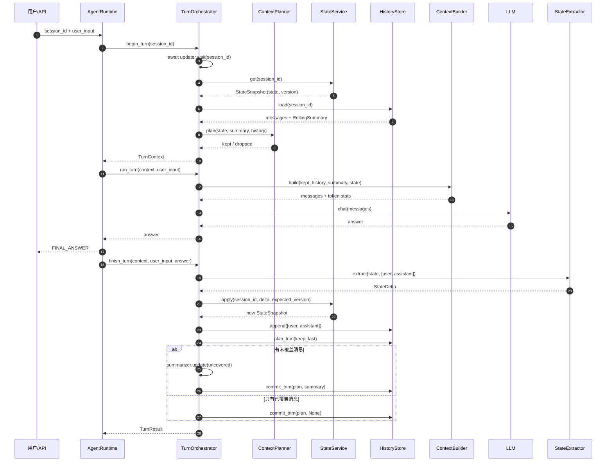

# 第 20.5 课：组件接入设计（加餐）

> 模块三 · 上下文与状态（加餐）
> 前置：第 20 课（`HistoryStore` 提供历史与摘要持久化）
> 下一课：第 20.6 课把聊天链路真正接进 `AgentRuntime`
> 预计用时：1-1.5 小时
> 本课性质：**设计课，不写实现代码**

---

## 0. 为什么单独加这一课

第 10-20 课已经做出了很多组件：

```text
TokenBudget
HistorySummarizer
SessionState / StateStore / SessionRegistry
StateService / StateExtractor
StateRenderer / ContextBuilder
TurnStateUpdater
HistoryStore
```

但它们大多只在测试和脚本里被调用。真实的 `AgentRuntime` 仍然是：

```python
messages = [
    {"role": "system", "content": system_prompt},
    {"role": "user", "content": user_input},
]
```

如果直接把所有组件一次性塞进 Runtime，会出现：

- session_id 没有定义；
- 状态、历史、摘要的加载顺序混乱；
- 聊天路径和任务路径各拼一套 messages；
- 状态更新失败时不知道是否影响回答；
- `StateStore` 和 `HistoryStore` 两个事务无法一起回滚；
- 测试只能测组件，测不到“下一轮还记得”。

所以先单独用一节课把**接入契约**定清楚，下一节再写代码。

**本课产出**

| 交付物 | 说明 |
|---|---|
| `docs/lessons/lesson20_5.md` | 组件接入设计文档 |
| 无代码、无测试 | 设计评审通过后再进入 20.6 |

---

## 1. 当前架构与目标差距

当前真实链路：

```text
API /chat
  → AgentRuntime
    → IntentRouter
      ├─ CHAT → ChatResponder → system + user
      └─ TASK → PlanRunner → TaskPlanner → Executor
```

已有但未接入：

```text
StateService / StateExtractor
ContextBuilder / StateRenderer
TurnStateUpdater
HistoryStore
```

目标不是“把组件都塞进 Runtime”，而是增加一个**回合编排层**：

```text
API /chat?session_id=...
  → AgentRuntime
    → TurnOrchestrator
      ├─ 等待上一轮后台更新
      ├─ 读 StateSnapshot
      ├─ 读 HistorySnapshot
      ├─ ContextBuilder.build(...)
      ├─ IntentRouter
      ├─ CHAT / TASK
      ├─ 回合后状态更新
      └─ 历史追加
```

关键区别：

| 现在 | 接入后 |
|---|---|
| Runtime 直接调用 responder | Runtime 调用 TurnOrchestrator |
| responder 自己拼 messages | ContextBuilder 统一组装 |
| 没有 session | session_id 贯穿 API / state / history |
| 状态更新不可见 | 回合后提取并持久化 |
| 重启失忆 | 从 SQLite 恢复 |

---

## 2. 本课要定下来的 7 个问题

### 2.1 谁负责“一轮”

建议新增 `TurnOrchestrator`，不要把逻辑塞进 `ChatResponder` 或 `TaskPlanner`。

职责：

```text
begin_turn(session_id)
  ├─ await updater.wait(session_id)
  ├─ snapshot = state_service.get(session_id)
  ├─ history = history_store.load(session_id)
  └─ 返回 TurnContext

run_turn(turn_context, user_input)
  ├─ 组装上下文
  ├─ 路由
  ├─ 调用聊天/任务
  └─ 返回回答与事件

finish_turn(turn_context, user_input, answer, turn_id)
  ├─ StateExtractor / TurnStateUpdater
  ├─ StateService.apply
  ├─ HistoryStore.append(...)
  ├─ plan = HistoryStore.plan_trim(...)
  ├─ covered-only: commit_trim(plan, None)
  ├─ uncovered: summarizer.update(plan.uncovered_messages)
  └─ uncovered: commit_trim(plan, summary)
```

`ChatResponder` 和 `TaskPlanner` 只负责“生成”，不负责“加载/持久化”。

### 2.2 session_id 必须成为一等公民

当前 [api/server.py](api/server.py:45) 的 `/chat` 只有 `message`，[runtime.py](agent/runtime.py:79) 的 `run()` 也只有 `user_input`。

接入后至少需要：

```python
async def run(
    self,
    user_input: str,
    session_id: str,
) -> AsyncIterator[RuntimeEvent]:
    ...
```

API：

```text
POST /chat
{
  "session_id": "session-1",
  "message": "我喜欢干型酒"
}
```

或者在 MVP 阶段先用 query 参数：

```text
GET /chat?session_id=session-1&message=...
```

但 `session_id` 必须进入：

- 状态读写；
- 历史读写；
- 事件；
- 日志/trace；
- 测试。

### 2.3 一次加载，多处使用

不要在 `ChatResponder`、`TaskPlanner`、`PlanRunner` 里各自 `get()` 状态。

推荐 `TurnContext`：

```python
@dataclass(frozen=True)
class TurnContext:
    session_id: str
    state: StateSnapshot
    history: HistorySnapshot
    turn_id: str
```

`begin_turn()` 只读一次：

```text
await updater.wait(session_id)
state = await state_service.get(session_id)
history = await history_store.load(session_id)
```

这样：

- 同一轮内状态版本一致；
- 不会重复读 SQLite；
- 不会因为另一个任务写入而前后不一致；
- 测试可以注入固定 context。

### 2.4 聊天先接，任务后接

第一版只接聊天路径：

```text
API → Runtime → TurnOrchestrator
  → ContextBuilder
  → ChatResponder
  → TurnStateUpdater
  → HistoryStore
```

原因：

- 聊天路径没有工具调用组，消息形状简单；
- 任务路径的 `PlanRunner._compose_answer()` 现在是：

```python
[
    system,
    user: 原始问题,
    user: 任务结果,
]
```

它需要额外的 `result_messages` 注入接口，不能直接套当前 `ContextBuilder` 的“当前 user 最后”契约。

任务路径放到 20.7 或第 21 课之后，单独处理：

- 计划阶段的上下文；
- 工具消息/结果的注入；
- 最终回答阶段的结果拼接；
- 任务执行中的状态更新。

### 2.5 ContextBuilder 保持“纯组装”

`ContextBuilder` 不应该变成新的 god object：

```text
ContextBuilder 只接收：
  system_prompt
  StateSnapshot
  RollingSummary
  history
  user_input
```

它不负责：

- 加载状态；
- 加载历史；
- 生成摘要；
- 追加历史；
- 更新状态。

因此：

- 聊天路径一个 `chat_builder`；
- 任务规划路径一个 `task_builder`；
- 两者共享 `TokenBudget` 和 counter，但 system prompt 不同。

### 2.6 回合后的写入顺序

推荐 MVP 顺序：

```text
1. 生成回答
2. 推送 FINAL_ANSWER 给用户
3. 提取 + 应用状态（可以后台）
4. 追加历史
5. 发 RUN_FINISHED
```

但这里有一个关键决策：

> 状态更新失败时，回答是否还算成功？

建议：

- 回答已经生成时，**不因为状态更新失败而撤回回答**；
- 状态更新失败要记录 `RuntimeEvent` / 日志 / 指标；
- 下一轮开始前可以重试或接受旧状态；
- 不能静默吞掉。

历史追加失败同理：

- 不影响已回答的用户；
- 记录错误；
- 下一轮历史可能缺一轮，要可观测。

### 2.7 两个 Store 的事务边界

`StateStore` 和 `HistoryStore` 共用 SQLite 文件，但各自提交：

```text
StateService.apply()        → 事务 A
HistoryStore.append()       → 事务 B
HistoryStore.plan_trim()    → 只读
HistoryStore.commit_trim()  → 事务 C
```

MVP 接受“最终一致”，但必须明确顺序：

| 顺序 | 失败后果 |
|---|---|
| 先状态，后历史 | 状态新、历史缺一轮；下一轮上下文缺少上一轮，但状态正确 |
| 先历史，后状态 | 历史有、状态旧；下一轮上下文完整，但模型看到旧状态 |

推荐 **先状态，后历史**：

- 状态是结构化事实，优先级更高；
- 历史缺失可以靠日志/重放补；
- 状态旧会让模型基于错误事实回答，影响更大。

如果后续要求严格一致，引入：

- `SessionStore` 事务门面；
- outbox 表 + 重放；
- 或把历史和状态放进同一个事务。

### 2.8 ContextPlanner：预算必须先分配

不要 `build → 摘要 → 再 build`。接入时用 `ContextPlanner`：

```text
available
├─ system prompt + 当前 user
├─ state 配额
├─ summary 配额
├─ history 配额
└─ safety margin
```

`ContextPlanner.plan()` 只做：

- 预算分配；
- 历史预裁剪；
- 返回 `kept_history` / `dropped_history`；
- 不调用 LLM、不读数据库。

`TurnOrchestrator` 的处理：

```text
plan = planner.plan(...)

如果 plan.dropped 中有未覆盖消息：
    summary = await summarizer.update(
        history.summary,
        uncovered_dropped_messages,
    )
    HistoryStore.save_summary(
        ...,
        covered_through_id=max(uncovered_ids),
    )

built = ContextBuilder.build(
    ...,
    summary=new_summary,
    history=plan.kept_history,
    state_max_tokens=plan.state_max_tokens,
)
```

这样 build 只执行一次，summary 和 history 都有固定上限。

---

## 3. 推荐的接入时序



---

## 4. 接口草案

### 4.1 `TurnContext`

```python
@dataclass(frozen=True)
class TurnContext:
    session_id: str
    turn_id: str
    state: StateSnapshot
    history: HistorySnapshot
```

### 4.2 `TurnOrchestrator`

```python
class TurnOrchestrator:
    async def begin_turn(self, session_id: str) -> TurnContext: ...
    async def run_chat(
        self,
        context: TurnContext,
        user_input: str,
    ) -> str: ...
    async def finish_turn(
        self,
        context: TurnContext,
        user_input: str,
        answer: str,
    ) -> None: ...
```

不要求第一版就把任务路径塞进来；先把聊天路径做通。

### 4.3 `ChatResponder` 的改造方向

现在：

```python
class ChatResponder:
    def __init__(self, llm, system_prompt): ...
    async def run(self, user_input, run_id=None): ...
```

接入后有两种方案：

**方案 A：传入已组装 messages**

```python
async def run(
    self,
    messages: list[dict],
    run_id: str | None = None,
) -> AsyncIterator[RuntimeEvent]:
```

推荐。`ChatResponder` 不再知道 system prompt 和上下文结构。

**方案 B：传入 ContextBuilder**

```python
async def run(self, user_input, context, run_id=None)
```

会让 responder 依赖 ContextBuilder，职责变重，不推荐。

### 4.4 `AgentRuntime` 的改造方向

```python
async def run(
    self,
    user_input: str,
    session_id: str,
) -> AsyncIterator[RuntimeEvent]:
    context = await self.orchestrator.begin_turn(session_id)
    async for event in self._run_route(context, user_input):
        yield event
```

`AgentRuntime` 仍然负责路由和事件流；`TurnOrchestrator` 负责上下文/状态/历史。

---

## 5. 测试计划（下一课实现）

### 5.1 单元测试

- `begin_turn()` 会先 `wait`，再读状态/历史；
- 缺失 session 返回空状态 + 空历史；
- `run_chat()` 使用 `ContextBuilder` 组装，而不是裸 system+user；
- `finish_turn()` 状态失败时仍保留回答，并产生错误事件；
- `finish_turn()` 追加历史时包含 user + assistant。

### 5.2 集成测试

- 第一轮说“我喜欢干型酒”；
- 第二轮问“推荐一款”，回答/上下文包含“干型”；
- 进程重启（新建 store 实例）后仍然记得；
- 状态版本只增加一次；
- 同一 session 重复 turn_id 不重复追加/应用。

### 5.3 真实 LLM 冒烟

复用 [real_llm_state_e2e.py](scripts/real_llm_state_e2e.py) 的思路，但走：

```text
AgentRuntime.run(user_input, session_id)
```

而不是脚本手动串组件。

---

## 6. 接入顺序

### 第 1 步：session_id 贯穿 API / Runtime

- API 接收 `session_id`；
- `AgentRuntime.run` 接收 `session_id`；
- 事件里带 `session_id`；
- 默认值只用于兼容旧调用。

### 第 2 步：TurnOrchestrator + 聊天路径

- `begin_turn`：wait + get state + load history；
- `run_chat`：ContextBuilder + ChatResponder；
- `finish_turn`：TurnStateUpdater + `HistoryStore.append` + 显式 `plan_trim/commit_trim`。

### 第 3 步：测试和真实冒烟

- 两轮聊天记忆；
- 重启恢复；
- 状态更新失败路径。

### 第 4 步：任务路径

- `TaskPlanner` 用 `task_builder`；
- `PlanRunner._compose_answer` 支持结果注入；
- 任务结束后的状态/历史更新。

### 第 5 步：EventBus

第 30 课再把 Runtime 直接 yield 改成 EventBus fan-out；本课不提前做。

---

## 7. 验收标准

本课（20.5）只要设计通过，不要求代码：

- [ ] 明确 `TurnContext` / `TurnOrchestrator` 职责
- [ ] 明确 session_id 的传递路径
- [ ] 明确聊天先接、任务后接
- [ ] 明确状态/历史写入顺序
- [ ] 明确失败时不撤回回答，但要可观测
- [ ] 明确 `StateStore` / `HistoryStore` 不是同一事务
- [ ] 明确下一课的测试计划

下一课（20.6）的完成标准：

```text
用户第一轮说“我喜欢干型酒”
第二轮问“推荐一款”
→ 回答能体现“干型”
→ 重启后仍然记得
```

---

## 8. 开放问题

1. `session_id` 由前端生成，还是服务端首次请求时创建？
2. 未登录用户是否允许匿名 session？匿名 session 保留多久？
3. 聊天路径和任务路径是否共用一个 `TurnContext` 加载函数？
4. 状态更新用 `await update()` 还是 `schedule()`？
   - MVP 可以先 `await`，逻辑简单；
   - 延迟敏感时再改后台。
5. 历史追加失败时，是否要重试？重试几次？
6. 任务路径的“本轮消息”是只包含最终回答，还是包含 tool_calls/tool 结果？
7. 状态更新失败是否要写入一个 `state_update_failed` 事件，供前端提示？
8. 是否需要在 `TurnContext` 里带 `user_id`，为第 36 课多用户做准备？

---

## 9. 下一课

第 20.6 课开始写代码：

```text
1. ContextPlanner
2. TurnContext / TurnOrchestrator
3. session_id 接入 API / AgentRuntime
4. ChatResponder 接收已组装 messages
5. finish_turn 接 TurnStateUpdater + HistoryStore.append + plan_trim/commit_trim
6. 两轮聊天 + 重启恢复测试
```

这一节只定契约，下一节才动 Runtime。
