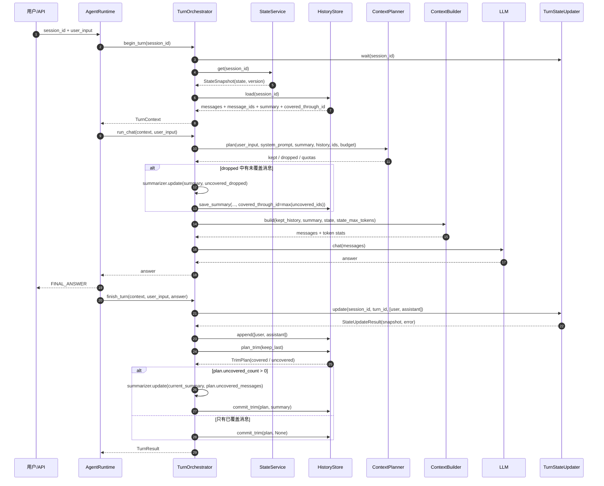

# 第 20.5 课：组件接入设计（加餐）

> 模块三 · 上下文与状态（加餐）
> 前置：第 20 课（`HistoryStore` + `ContextPlanner`）
> 下一课：第 20.6 课把聊天链路真正接进 `AgentRuntime`
> 预计用时：1-1.5 小时
> 本课性质：**设计课，不写实现代码**
> 本版按第 20 课最终实现修订：D 模型 + 请求级/存储级两级裁剪。
> 实现状态：第 20.6 课已按本设计接入 Runtime，见 [lesson20_6.md](lesson20_6.md)。

---

## 0. 为什么单独加这一课

第 10-20 课已经做出了很多组件：

```text
TokenBudget
HistorySummarizer
SessionState / StateStore / SessionStateRegistry
StateService / StateExtractor
StateRenderer / ContextBuilder
TurnStateUpdater
HistoryStore
ContextPlanner
```

但它们大多只在测试和脚本里被调用。真实的 `AgentRuntime` 仍然是：

```python
messages = [
    {"role": "system", "content": system_prompt},
    {"role": "user", "content": user_input},
]
```

如果直接把所有组件一次性塞进 Runtime，会出现：

- session_id 没有定义；
- 状态、历史、摘要的加载顺序混乱；
- 聊天路径和任务路径各拼一套 messages；
- 状态更新失败时不知道是否影响回答；
- `StateStore` 和 `HistoryStore` 两个事务无法一起回滚；
- 测试只能测组件，测不到“下一轮还记得”。

所以先单独用一节课把**接入契约**定清楚，下一节再写代码。

**本课产出**

| 交付物 | 说明 |
|---|---|
| `docs/lessons/lesson20_5.md` | 组件接入设计文档 |
| 无代码、无测试 | 设计评审通过后再进入 20.6 |

---

## 1. 当前架构与目标差距

当前真实链路：

```text
API /chat
  → AgentRuntime
    → IntentRouter
      ├─ CHAT → ChatResponder → system + user
      └─ TASK → PlanRunner → TaskPlanner → Executor
```

已有但未接入：

```text
StateService / StateExtractor
ContextPlanner
ContextBuilder / StateRenderer
TurnStateUpdater
HistoryStore
```

目标不是“把组件都塞进 Runtime”，而是增加一个**回合编排层**：

```text
API /chat?session_id=...
  → AgentRuntime
    → TurnOrchestrator
      ├─ begin_turn：等待上一轮更新，读 StateSnapshot + HistorySnapshot
      ├─ IntentRouter
      ├─ CHAT → run_chat（Planner → 请求级摘要 → Builder → Responder）
      │        → finish_turn（状态更新 → 历史追加 → plan_trim / commit_trim）
      └─ TASK → 旧链路，20.7 再接
```

关键区别：

| 现在 | 接入后 |
|---|---|
| Runtime 直接调用 responder | Runtime 调用 TurnOrchestrator |
| responder 自己拼 messages | ContextBuilder 统一组装 |
| 没有 session | session_id 贯穿 API / state / history |
| 状态更新不可见 | 回合后提取并持久化 |
| 重启失忆 | 从 SQLite 恢复 |

---

## 2. 本课要定下来的 8 个问题

### 2.1 谁负责“一轮”

建议新增 `TurnOrchestrator`，不要把逻辑塞进 `ChatResponder` 或 `TaskPlanner`。

职责：

```text
begin_turn(session_id)
  ├─ await updater.wait(session_id)
  ├─ state = await state_service.get(session_id)
  ├─ history = history_store.load(session_id)
  └─ 返回 TurnContext(state, history)

run_chat(turn_context, user_input)
  ├─ plan = planner.plan(
  │      user_input, system_prompt,
  │      history.summary, history.messages,
  │      history.message_ids, budget,
  │  )
  ├─ 请求级摘要：只摘要 plan 中未覆盖的 dropped 消息
  ├─ built = builder.build(...)
  └─ ChatResponder.run(built.messages)

finish_turn(turn_context, user_input, answer, turn_id)
  ├─ await updater.update(session_id, turn_id, [user, assistant])
  ├─ history_store.append(session_id, [user, assistant])
  ├─ plan = history_store.plan_trim(session_id, keep_last=...)
  ├─ covered-only: commit_trim(plan, None)
  ├─ uncovered: summarizer.update(plan.uncovered_messages)
  └─ uncovered: commit_trim(plan, summary)
```

`ChatResponder` 和 `TaskPlanner` 只负责“生成”，不负责“加载/持久化”。

`ContextPlanner.plan()` 需要 `user_input` 和 `system_prompt`，所以放在
`run_chat()`，不能放在只接收 `session_id` 的 `begin_turn()`。

### 2.2 session_id 必须成为一等公民

当前 [api/server.py](../../api/server.py:45) 的 `/chat` 只有 `message`，[runtime.py](../../agent/runtime.py:79) 的 `run()` 也只有 `user_input`。

接入后至少需要：

```python
async def run(
    self,
    user_input: str,
    session_id: str,
) -> AsyncIterator[RuntimeEvent]:
    ...
```

API：

```text
POST /chat
{
  "session_id": "session-1",
  "message": "我喜欢干型酒"
}
```

或者在 MVP 阶段先用 query 参数：

```text
GET /chat?session_id=session-1&message=...
```

但 `session_id` 必须进入：

- 状态读写；
- 历史读写；
- 事件；
- 日志/trace；
- 测试。

### 2.3 一次加载，多处使用

不要在 `ChatResponder`、`TaskPlanner`、`PlanRunner` 里各自 `get()` 状态。

推荐 `TurnContext`：

```python
@dataclass(frozen=True)
class TurnContext:
    session_id: str
    state: StateSnapshot
    history: HistorySnapshot
    turn_id: str
```

`begin_turn()` 只读一次：

```text
await updater.wait(session_id)
state = await state_service.get(session_id)
history = history_store.load(session_id)
```

`HistorySnapshot` 必须同时带回：

```text
messages
message_ids
summary
covered_through_id
```

因为请求级裁剪和存储级裁剪都要判断“哪些消息已经进入摘要”，不能只看
`messages` 的下标。

`HistoryStore` 是同步 SQLite；如果事件循环对延迟敏感，可以在
`TurnOrchestrator` 里统一用 `asyncio.to_thread()` 包一层，但接口语义不变。

这样：

- 同一轮内状态版本一致；
- 不会重复读 SQLite；
- 不会因为另一个任务写入而前后不一致；
- 测试可以注入固定 context。

### 2.4 聊天先接，任务后接

第一版只接聊天路径：

```text
API → Runtime → TurnOrchestrator
  → ContextPlanner
  → ContextBuilder
  → ChatResponder
  → TurnStateUpdater
  → HistoryStore（append / trim）
```

原因：

- 聊天路径没有工具调用组，消息形状简单；
- 任务路径的 `PlanRunner._compose_answer()` 现在是：

```python
[
    system,
    user: 原始问题,
    user: 任务结果,
]
```

它需要额外的 `result_messages` 注入接口，不能直接套当前 `ContextBuilder` 的“当前 user 最后”契约。

任务路径放到 20.7 或第 21 课之后，单独处理：

- 计划阶段的上下文；
- 工具消息/结果的注入；
- 最终回答阶段的结果拼接；
- 任务执行中的状态更新。

### 2.5 ContextBuilder 保持“纯组装”

`ContextBuilder` 不应该变成新的 god object：

```text
ContextBuilder(system_prompt, budget)
  └─ 只保存固定配置

build(
    user_input,
    state=StateSnapshot.state,
    summary=RollingSummary,
    history=kept_history,
    state_max_tokens=plan.state_max_tokens,
)
  └─ 只组装本轮 messages
```

它不负责：

- 加载状态；
- 加载历史；
- 调用 `ContextPlanner`；
- 生成摘要；
- 追加历史；
- 更新状态。

预算配额由 `ContextPlanner` 决定，`ContextBuilder` 只按配额渲染和组装；
`TokenBudget.fit()` 只做最后兜底。

因此：

- 聊天路径一个 `chat_builder`；
- 任务规划路径一个 `task_builder`；
- 两者共享 `TokenBudget` 和 counter，但 system prompt 不同。

### 2.6 回合后的写入顺序

推荐 MVP 顺序：

```text
1. 生成回答
2. 推送 FINAL_ANSWER 给用户
3. 提取 + 应用状态（可以后台）
4. 追加历史
5. 发 RUN_FINISHED
```

但这里有一个关键决策：

> 状态更新失败时，回答是否还算成功？

建议：

- 回答已经生成时，**不因为状态更新失败而撤回回答**；
- 状态更新失败要记录 `RuntimeEvent` / 日志 / 指标；
- 下一轮开始前可以重试或接受旧状态；
- 不能静默吞掉。

历史追加失败同理：

- 不影响已回答的用户；
- 记录错误；
- 下一轮历史可能缺一轮，要可观测。

### 2.7 两个 Store 的事务边界

`StateStore` 和 `HistoryStore` 共用 SQLite 文件，但各自提交：

```text
StateService.apply()          → 事务 A
HistoryStore.save_summary()   → 事务 B（请求级裁剪，只改摘要和 coverage）
HistoryStore.append()         → 事务 C
HistoryStore.plan_trim()      → 只读
HistoryStore.commit_trim()    → 事务 D（删除 + 摘要 + coverage，原子）
```

注意：

- `save_summary()` 可以只推进 `covered_through_id`，**不删除消息**；
- `commit_trim()` 才负责物理删除；
- `commit_trim()` 的删除、摘要、水位线推进必须在同一个事务里；
- 如果 `commit_trim()` 失败，旧消息仍在库中，下一轮 `plan_trim()` 会重新生成计划并重试，不会丢历史。

MVP 接受“最终一致”，但必须明确顺序：

| 顺序 | 失败后果 |
|---|---|
| 先状态，后历史 | 状态新、历史缺一轮；下一轮上下文缺少上一轮，但状态正确 |
| 先历史，后状态 | 历史有、状态旧；下一轮上下文完整，但模型看到旧状态 |

推荐 **先状态，后历史**：

- 状态是结构化事实，优先级更高；
- 历史缺失可以靠日志/重放补；
- 状态旧会让模型基于错误事实回答，影响更大。

如果后续要求严格一致，引入：

- `SessionStore` 事务门面；
- outbox 表 + 重放；
- 或把历史和状态放进同一个事务。

### 2.8 ContextPlanner：预算先分配，请求裁剪和存储裁剪分开

不要 `build → 摘要 → 再 build`。接入后有两级裁剪，必须分开处理：

```text
请求级裁剪（run_chat）  → 决定本轮 prompt，并推进摘要/coverage；不删消息
存储级裁剪（finish_turn）→ 真正删除数据库消息
```

如果请求级不摘要、非要等存储裁剪才摘要，被本轮 prompt 丢掉的信息会在多轮里
持续缺失，所以请求级必须先摘要并推进 coverage。

#### 请求级裁剪

`ContextPlanner.plan()` 先固定分配预算：

```text
available
├─ system prompt + 当前 user
├─ state 配额
├─ summary 配额
├─ history 配额
└─ safety margin
```

它只做：

- 预算分配；
- 历史预裁剪；
- 返回 `kept_history` / `kept_message_ids` / `dropped_history` / `dropped_message_ids`；
- 不调用 LLM、不读数据库、不删除消息。

`TurnOrchestrator` 的处理：

```python
plan = planner.plan(
    user_input=user_input,
    system_prompt=builder.system_prompt,
    summary=history.summary,
    history=history.messages,
    message_ids=history.message_ids,
    budget=builder.budget,
)

covered = history.covered_through_id or 0
uncovered_pairs = [
    (message_id, message)
    for message_id, message in zip(
        plan.dropped_message_ids,
        plan.dropped_history,
    )
    if message_id > covered
]
uncovered_ids = tuple(item[0] for item in uncovered_pairs)
uncovered_messages = tuple(item[1] for item in uncovered_pairs)

if uncovered_messages:
    summary = await summarizer.update(
        history.summary,
        uncovered_messages,
    )
    history_store.save_summary(
        session_id,
        summary,
        covered_through_id=max(uncovered_ids),
    )
else:
    summary = history.summary

built = builder.build(
    user_input,
    state=state.state,
    summary=summary,
    history=plan.kept_history,
    state_max_tokens=plan.state_max_tokens,
)
```

关键点：

- `plan.dropped_history` 只是本轮 prompt 不用，**数据库里的消息还在**；
- 只摘要 `id > covered_through_id` 的 dropped 消息，已覆盖的不能重复摘要；
- `save_summary(covered_through_id=...)` 只推进 coverage，不删除消息；
- 这样 coverage 可以领先于物理删除，后续存储裁剪看到这些消息已覆盖，直接删即可；
- `ContextBuilder.build()` 只执行一次，summary 和 history 都有固定上限；
- 摘要器应把 `plan.summary_text_max_tokens` 作为正文长度上限；如果 build 后仍有
  `dropped_messages`，记录指标并接受兜底，不允许再触发一轮摘要和 build。

如果请求级 `save_summary()` 失败：

- 记录错误，本轮仍可用内存里的 `summary` 组装；
- 不要假装 coverage 已推进；
- `finish_turn` 重新读取摘要时会看到旧 coverage，`plan_trim()` 会把这些消息重新摘要一次（至少一次语义）；
- 允许重复摘要，但不能丢消息，也不能静默吞掉异常。

#### 存储级裁剪

`finish_turn()` 在历史追加之后，才根据实际消息数量决定是否删除：

```python
history_store.append(session_id, [user_message, assistant_message])

plan = history_store.plan_trim(session_id, keep_last=...)
if plan.is_empty:
    return

if plan.uncovered_count == 0:
    history_store.commit_trim(plan, None)
else:
    current_summary = history_store.load(session_id).summary
    summary = await summarizer.update(
        current_summary,
        plan.uncovered_messages,
    )
    history_store.commit_trim(plan, summary)
```

注意：`finish_turn()` 不能直接用 `TurnContext.history.summary` 做存储级摘要，
因为请求级裁剪可能已经推进了摘要和 coverage；应在 `plan_trim()` 前重新读取，
或由 `run_chat()` 显式把 `summary_used` 传给 `finish_turn()`。

两级裁剪的配合：

```text
本轮 prompt 丢了 m1~m3
→ 请求级摘要 m1~m3，coverage 推进到 3
→ m1~m3 仍在库里
→ 本轮结束 append 新消息
→ 存储裁剪发现 m1~m3 已覆盖
→ commit_trim(plan, None) 直接删除
→ 不再调用 LLM 摘要
```

---

## 3. 推荐的接入时序



时序里的 `save_summary()` 和 `commit_trim()` 是两次独立的写操作：

- 前者发生在生成回答之前，只推进摘要和 coverage；
- 后者发生在回答之后，才真正删除消息。

---

## 4. 接口草案

### 4.1 `TurnContext`

```python
@dataclass(frozen=True)
class TurnContext:
    session_id: str
    turn_id: str
    state: StateSnapshot
    history: HistorySnapshot
    # history 含 messages / message_ids / summary / covered_through_id
    # plan 不放在这里：plan 需要 user_input 和 system_prompt，在 run_chat 里计算
```

### 4.2 `TurnOrchestrator`

```python
class TurnOrchestrator:
    async def begin_turn(self, session_id: str) -> TurnContext: ...

    async def run_chat(
        self,
        context: TurnContext,
        user_input: str,
    ) -> str:
        # 内部顺序：
        # 1. planner.plan(...)
        # 2. 请求级摘要 + save_summary(...)
        # 3. builder.build(...)
        # 4. ChatResponder.run(built.messages)
        ...

    async def finish_turn(
        self,
        context: TurnContext,
        user_input: str,
        answer: str,
    ) -> None:
        # 内部顺序：
        # 1. TurnStateUpdater.update(...)
        # 2. HistoryStore.append(...)
        # 3. HistoryStore.plan_trim(...)
        # 4. commit_trim(plan, None / summary)
        ...
```

`begin_turn()` 只加载快照；`run_chat()` 才做规划和请求级摘要，因为后者需要
`user_input` 和 `system_prompt`。不要求第一版就把任务路径塞进来；先把聊天路径做通。

### 4.3 `ChatResponder` 的改造方向

现在：

```python
class ChatResponder:
    def __init__(self, llm, system_prompt): ...
    async def run(self, user_input, run_id=None): ...
```

接入后有两种方案：

**方案 A：传入已组装 messages**

```python
async def run(
    self,
    messages: list[dict],
    run_id: str | None = None,
) -> AsyncIterator[RuntimeEvent]:
```

推荐。`ChatResponder` 不再知道 system prompt 和上下文结构。

**方案 B：传入 ContextBuilder**

```python
async def run(self, user_input, context, run_id=None)
```

会让 responder 依赖 ContextBuilder，职责变重，不推荐。

### 4.4 `AgentRuntime` 的改造方向

```python
async def run(
    self,
    user_input: str,
    session_id: str,
) -> AsyncIterator[RuntimeEvent]:
    context = await self.orchestrator.begin_turn(session_id)
    async for event in self._run_route(context, user_input):
        yield event
```

`AgentRuntime` 仍然负责路由和事件流；`TurnOrchestrator` 负责上下文/状态/历史。

---

## 5. 测试计划（下一课实现）

### 5.1 单元测试

- `begin_turn()` 会先 `wait`，再读状态/历史；
- `begin_turn()` 返回的 `HistorySnapshot` 带 `message_ids` 和 `covered_through_id`；
- 缺失 session 返回空状态 + 空历史；
- `run_chat()` 使用 `ContextPlanner` 规划，再 `ContextBuilder` 组装，而不是裸 system+user；
- `run_chat()` 只 build 一次，不出现 `build → 摘要 → build` 循环；
- 请求级 dropped 中有未覆盖消息时，只摘要这些消息，并 `save_summary` 推进 coverage；
- 请求级 dropped 全部已覆盖时，不调用摘要器；
- 请求级 `save_summary` 失败时，回答仍可生成，但错误可观测；
- `finish_turn()` 状态失败时仍保留回答，并产生错误事件；
- `finish_turn()` 追加历史时包含 user + assistant；
- `finish_turn()` 的 plan 全部已覆盖时，`commit_trim(plan, None)`，不再调用摘要器；
- `finish_turn()` 的 plan 有未覆盖消息时，只摘要 `plan.uncovered_messages`。

### 5.2 集成测试

- 第一轮说“我喜欢干型酒”；
- 第二轮问“推荐一款”，回答/上下文包含“干型”；
- 进程重启（新建 store 实例）后仍然记得；
- 状态版本只增加一次；
- 请求级裁剪推进 coverage 后，消息仍在数据库中；
- 后续存储裁剪直接删除已覆盖消息，摘要器调用次数不增加；
- 同一 session 重复 turn_id 不重复应用状态（`TurnStateUpdater` 已幂等）。

### 5.3 真实 LLM 冒烟

复用 [real_llm_state_e2e.py](../../scripts/real_llm_state_e2e.py) 的思路，但走：

```text
AgentRuntime.run(user_input, session_id)
```

而不是脚本手动串组件。

---

## 6. 接入顺序

### 第 1 步：session_id 贯穿 API / Runtime

- API 接收 `session_id`；
- `AgentRuntime.run` 接收 `session_id`；
- 事件里带 `session_id`；
- 默认值只用于兼容旧调用。

### 第 2 步：TurnOrchestrator + 聊天路径

- `begin_turn`：wait + get state + load history（含 ids / coverage）；
- `run_chat`：`ContextPlanner.plan` → 请求级摘要/`save_summary` → `ContextBuilder.build` → `ChatResponder`；
- `finish_turn`：`TurnStateUpdater` + `HistoryStore.append` + 显式 `plan_trim/commit_trim`。

### 第 3 步：测试和真实冒烟

- 两轮聊天记忆；
- 重启恢复；
- 请求级裁剪后 coverage 领先删除；
- 存储裁剪不重复摘要；
- 状态更新失败路径。

### 第 4 步：任务路径

- `TaskPlanner` 用 `task_builder`；
- `PlanRunner._compose_answer` 支持结果注入；
- 任务结束后的状态/历史更新。

### 第 5 步：EventBus

第 30 课再把 Runtime 直接 yield 改成 EventBus fan-out；本课不提前做。

---

## 7. 验收标准

本课（20.5）只要设计通过，不要求代码：

- [ ] 明确 `TurnContext` / `TurnOrchestrator` 职责
- [ ] 明确 session_id 的传递路径
- [ ] 明确聊天先接、任务后接
- [ ] 明确状态/历史写入顺序
- [ ] 明确失败时不撤回回答，但要可观测
- [ ] 明确 `StateStore` / `HistoryStore` 不是同一事务
- [ ] 明确请求级裁剪决定本轮 prompt，但不删除数据库消息
- [ ] 明确请求级未覆盖消息先摘要并推进 coverage，不物理删除
- [ ] 明确存储级 `plan_trim/commit_trim` 区分 covered / uncovered
- [ ] 明确 coverage 可以领先于物理删除，且不会重复摘要
- [ ] 明确下一课的测试计划

下一课（20.6）的完成标准：

```text
用户第一轮说“我喜欢干型酒”
第二轮问“推荐一款”
→ 回答能体现“干型”
→ 重启后仍然记得
```

---

## 8. 开放问题

1. `session_id` 由前端生成，还是服务端首次请求时创建？
2. 未登录用户是否允许匿名 session？匿名 session 保留多久？
3. 聊天路径和任务路径是否共用一个 `TurnContext` 加载函数？
4. 状态更新用 `await update()` 还是 `schedule()`？
   - MVP 可以先 `await`，逻辑简单；
   - 延迟敏感时再改后台。
5. 历史追加失败时，是否要重试？重试几次？
6. 任务路径的“本轮消息”是只包含最终回答，还是包含 tool_calls/tool 结果？
7. 状态更新失败是否要写入一个 `state_update_failed` 事件，供前端提示？
8. 是否需要在 `TurnContext` 里带 `user_id`，为第 36 课多用户做准备？
9. 重复 `finish_turn()` 如何保证历史只追加一次？
   - `HistoryStore` 当前没有 `turn_id` 列；
   - 可以先在 `TurnOrchestrator` 内存去重，重启后用日志/额外 turn 表补齐。
10. 请求级 `save_summary()` 失败时，本轮是继续用内存摘要回答，还是直接失败重试？

---

## 9. 下一课

第 20.6 课开始写代码。`ContextPlanner` 已在第 20 课实现，下一课只接入，不重复实现：

```text
1. TurnContext / TurnOrchestrator
2. session_id 接入 API / AgentRuntime
3. begin_turn：wait + load state/history
4. run_chat：planner.plan + 请求级摘要 + ContextBuilder + ChatResponder
5. finish_turn：TurnStateUpdater + HistoryStore.append + plan_trim/commit_trim
6. 两轮聊天 + coverage 领先删除 + 重启恢复测试
```

这一节只定契约；20.6 已按本课契约实现，见 [lesson20_6.md](lesson20_6.md)。
